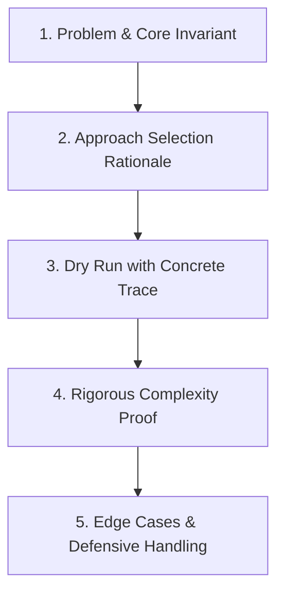

# DeltaX Round 4 — Coding Defense & Notepad Live Interview Strategy

> **Historical Interview Reality**:
> In DeltaX Technical Interviews, interviewers almost invariably open your **Round 3 Coding Test submissions** or ask you to share your screen and open a blank **Notepad / Google Doc**.
> They will ask you to:
> 1. *"Walk me through your code for Problem 2."*
> 2. *"Why did you use a HashMap instead of sorting?"*
> 3. *"What is the exact time and space complexity?"*
> 4. *"How does your code behave on this edge case: `[ -5, 0, -5 ]`?"*
> 5. *"Rewrite this in Notepad right now without an IDE."*

---

## The 5-Step Code Defense Framework (The "PADRE" Method)

When asked to explain any problem you wrote in Round 3, follow this structured formula:



### 1. **P**roblem & Core Invariant (30 seconds)
- State the objective and the fundamental mathematical or algorithmic property you exploited.
- *Script*: *"The objective was to find all contiguous subarrays summing to K. The core invariant here is that if the cumulative sum up to index $j$ is $S_j$ and up to index $i$ is $S_i$, the subarray between $i+1$ and $j$ sums to $K$ if and only if $S_j - S_i = K$, or $S_i = S_j - K$."*

### 2. **A**pproach Selection Rationale (45 seconds)
- Explain why you chose this specific pattern over the brute force alternative.
- *Script*: *"A brute force nested loop would check all $\frac{N(N+1)}{2}$ subarrays, resulting in $O(N^2)$ time, which would time out on $N = 10^5$. Since we only need the count of previous prefix sums, storing prefix frequencies in a Hash Map reduces the lookup to $O(1)$, yielding an optimal $O(N)$ single-pass solution."*

### 3. **D**ry Run with Concrete Trace (60 seconds)
- Do not read code line-by-line. Walk through a 4-element trace:
  - *"Let's take `nums = [1, 2, 3]`, `k = 3`. We initialize `map = {0: 1}`.*
  - *At index 0: `sum = 1`. `sum - k = 1 - 3 = -2` (not in map). Put `1` in map.*
  - *At index 1: `sum = 3`. `sum - k = 3 - 3 = 0`. `0` is in map with count 1. Total count becomes 1. Put `3` in map.*
  - *At index 2: `sum = 6`. `sum - k = 6 - 3 = 3`. `3` is in map with count 1. Total count becomes 2. Return 2."*

### 4. **R**igorous Complexity Proof (30 seconds)
- Give **both** Time and Space complexities, and justify both:
  - *Time Complexity*: $O(N)$ because we iterate through the array of length $N$ exactly once, and Hash Map insertions and lookups operate in $O(1)$ average time.
  - *Auxiliary Space*: $O(N)$ in the worst case where all prefix sums are distinct, requiring $N$ entries in our hash table.

### 5. **E**dge Cases & Defensive Handling (45 seconds)
- Volunteer how your code handles boundaries before the interviewer asks:
  - Negative numbers (why Two Pointers won't work, but Prefix Sum does).
  - Empty arrays or $N=1$.
  - Integer overflow (using `long` in Java/C++ when sums exceed $2^{31}-1$).

---

## Notepad Live-Coding Playbook

DeltaX technical rounds frequently ask candidates to type clean code directly into plain **Notepad** (no syntax highlighting, no auto-complete, no compiler).

### Rule 1: Always Declare Types and Imports
In plain text editors, writing sloppy pseudo-code loses marks. Write syntactically valid Java or Python:
```java
// Good Notepad Habit
import java.util.*;

public class Solution {
    public static int findTarget(int[] nums, int target) {
        if (nums == null || nums.length == 0) return -1;
        // logic
    }
}
```

### Rule 2: Indent Consistently (4 Spaces)
Do not use erratic tabs. Indent method bodies, loops, and conditions with clean 4 spaces. It proves code hygiene and discipline.

### Rule 3: Guard Clauses First
Begin every function with defensive boundary checks:
```python
# Python defensive checks
def solve(arr: list[int], k: int) -> int:
    if not arr or k <= 0:
        return 0
    # continue
```

### Rule 4: Verbalize While Typing
Never type in silence for 3 minutes. Communicate your thought process:
- *"I am now creating the frequency map to track character occurrences..."*
- *"I am adding a while loop to contract the sliding window from the left whenever our distinct count exceeds K..."*

---

## 5 Live Defense Scripts for DeltaX Core Problems

### Script 1: Defending "Rotten Oranges / Multi-Source BFS"
- **Interviewer**: *"Why did you use a Queue? Why not simple recursion/DFS?"*
- **Candidate Defense**: *"DFS explores one branch to its maximum depth first. If we used DFS, an infection branch might traverse 5 steps deep while another infection source was only 1 step away from the same fresh orange. DFS would assign an incorrect, inflated time value to that orange. Because all infections spread simultaneously at 1 unit of distance per minute, this represents an unweighted shortest path problem across multiple origins. Multi-source BFS using a FIFO Queue guarantees level-by-level exploration, ensuring each fresh orange is infected at the absolute minimum timestamp."*

### Script 2: Defending "Two Sum: Sorting + Two Pointers vs Hash Map"
- **Interviewer**: *"You solved this using a Hash Map in $O(N)$ time and $O(N)$ space. Can you solve it in $O(1)$ auxiliary space?"*
- **Candidate Defense**: *"Yes. If we are permitted to modify the array or return values instead of original indices, we can sort the array in $O(N \log N)$ time and apply the Two Pointers technique with `left = 0` and `right = N - 1`. If `nums[left] + nums[right] < target`, we increment `left`; if greater, we decrement `right`. This achieves $O(1)$ auxiliary space at the cost of $O(N \log N)$ time. However, if the original indices must be returned, sorting requires creating an auxiliary array of index pairs, which reintroduces $O(N)$ space."*

### Script 3: Defending "0/1 Knapsack: 2D vs 1D Space Optimization"
- **Interviewer**: *"Can you reduce the space complexity of your dynamic programming solution?"*
- **Candidate Defense**: *"In the standard 2D recurrence $dp[i][w] = \max(dp[i-1][w], dp[i-1][w - wt[i]] + val[i])$, row $i$ only depends on row $i-1$. Therefore, we do not need to store the entire $N \times W$ matrix. We can collapse it into a single 1D array of size $W+1$. To prevent using the same item multiple times within the same iteration, we must traverse the weight budget backwards from $W$ down to $wt[i]$. This reduces auxiliary space from $O(N \cdot W)$ to $O(W)$."*

### Script 4: Defending "String Parsing / URL Query Sanitizer"
- **Interviewer**: *"What if the URL parameter string is 50MB in size and cannot fit into memory all at once?"*
- **Candidate Defense**: *"In a streaming scenario, we would not use `String.split('&')` because that allocates thousands of substring objects in heap memory. Instead, we would process the stream character-by-character using a state machine with two pointer offsets (`key_start`, `key_end`, `val_start`, `val_end`). As soon as an ampersand delimiter is parsed, the validated key-value pair is emitted directly or written to disk, keeping working memory at $O(1)$ buffer size."*

### Script 5: Handling a Bug Discovered by the Interviewer
- **Interviewer**: *"Look at line 14. What happens if `nums = [0, 0, 0]` and `k = 0`?"*
- **Candidate Response (Do NOT get defensive or panic)**:
  - Step 1: *"Let me trace that specific input through line 14."*
  - Step 2: Trace calmly out loud: *"With `sum = 0` and `k = 0`, `sum - k = 0`. Our map initialized with `{0: 1}`..."*
  - Step 3: Acknowledge and fix gracefully: *"Ah, excellent observation. In that scenario, because `0` appears repeatedly, the frequency accumulates. If our condition checked `> 0` before inserting, it would miss subsequent zero additions. To fix this, we update the frequency map after updating the answer count rather than before."*
