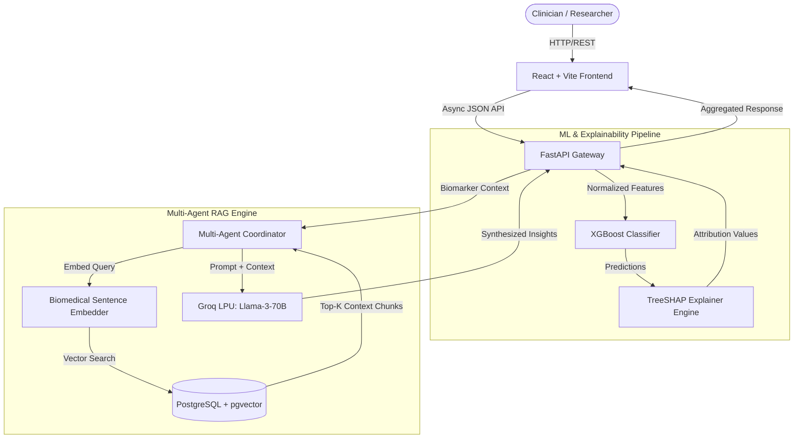
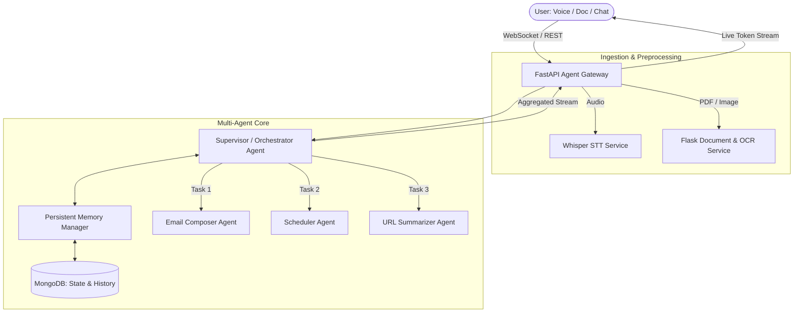

# DeltaX Round 4 — Projects Deep Dive & Technical Defense

> Comprehensive interview preparation for all four candidate projects:
> 1. **ADAM-1 Enhanced** (Alzheimer's & Microbiome AI Research Platform)
> 2. **Simha AI** (Multi-Agent Multimodal AI Platform)
> 3. **Smart Loan Approval System** (MERN + Machine Learning)
> 4. **Akki AI Assistant** (Telegram + n8n + LLM + Voice + Workflow Automation)
>
> *Note on Candidate Verification*: Unconfirmed architecture details or environment choices are strictly tagged `[VERIFY WITH USER]`.

---

# PROJECT 1: ADAM-1 Enhanced

### Overview & Tech Stack
- **Domain**: Computational Biology, Neurodegenerative Diagnostics, Explainable AI
- **Stack**: FastAPI (Backend), React / Vite (Frontend), PostgreSQL with `pgvector` (Vector Database), Groq AI (Llama-3-70B ultra-low latency inference), Machine Learning (XGBoost / Random Forest), SHAP (SHapley Additive exPlanations), Multi-Agent RAG workflow.

---

### Pitch Formats

#### 30-Second Elevator Pitch
> *"ADAM-1 Enhanced is an AI-powered diagnostic and research platform that investigates the gut-microbiome-to-brain axis for early Alzheimer’s disease detection. Using a high-performance FastAPI and React architecture, it combines XGBoost biomarker classification with SHAP explainability and a multi-agent RAG pipeline using PostgreSQL `pgvector` and Groq Llama-3. It empowers clinicians to not only predict cognitive decline risk, but understand the exact biological taxonomic drivers behind every prediction in under 800 milliseconds."*

#### 60-Second Technical Pitch
> *"Traditional Alzheimer’s diagnostics rely on late-stage cognitive exams or invasive CSF biomarkers. ADAM-1 Enhanced shifts detection left by analyzing gut microbiome metagenomic sequencing and patient clinical telemetry. On the backend, we run an asynchronous FastAPI microservice backed by PostgreSQL and pgvector for semantic literature retrieval.
> Our ML pipeline feeds normalized bacterial taxonomic abundance into an XGBoost classifier, immediately generating SHAP feature attribution values so clinicians see which taxa contributed to the risk score. For research exploration, we orchestrated a multi-agent workflow powered by Groq Llama-3 that interrogates biomedical papers stored in pgvector using Cosine Similarity. The frontend is built on React and Vite with interactive visualizations, delivering a sub-second, clinically interpretable decision-support platform."*

#### 2-Minute Architectural Walkthrough
> *"When designing ADAM-1 Enhanced, our primary architectural objective was clinical interpretability and low-latency insight.
> The architecture consists of three decoupled tiers:
> First, the ingestion and ML inference layer. Patient metagenomic profiles—specifically OTU (Operational Taxonomic Unit) abundance vectors—are uploaded via a secure FastAPI endpoint. The data is validated using Pydantic schemas, normalized, and piped into our trained gradient-boosted tree model. Instead of returning an opaque black-box probability, the pipeline triggers a TreeSHAP explainer that calculates exact log-odds contributions for every bacterial genus.
> Second, our Multi-Agent RAG knowledge layer. When a clinician questions a specific biomarker—say, a reduction in *Bifidobacterium* or increase in *Bacteroides*—a multi-agent coordinator dispatches queries. We embed queries using a biomedical sentence transformer model, execute an IVFFlat or HNSW cosine similarity search in PostgreSQL using the pgvector extension, and feed the top-k clinical evidence chunks to Groq-hosted Llama-3 models. Groq's LPU architecture provides 300+ tokens/second, enabling real-time synthesis of medical literature.
> Third, the presentation layer: React with Vite and Tailwind/Chart.js rendering real-time SHAP waterfall plots, risk gauges, and interactive agent dialogue. State is managed reactively, providing clinicians with instant biological explanations and cited literature."*

---

### System Architecture Diagram



---

### Data Flow & API Design
1. **POST `/api/v1/predict`**: Accepts JSON containing patient age, clinical indicators, and normalized relative taxonomic abundance array (`{"Bacteroides": 0.24, "Firmicutes": 0.61, ...}`).
2. **Pydantic Validation**: Validates sum of relative abundances $\approx 1.0$, checks value ranges.
3. **Inference Execution**: Model predicts probability $P(\text{Alzheimer's})$.
4. **SHAP Generation**: Computes local SHAP values array for top 10 influential features.
5. **POST `/api/v1/agent/query`**: Accepts natural language question about specific biomarkers. Executes pgvector similarity query:
   ```sql
   SELECT chunk_text, 1 - (embedding <=> $1) AS similarity
   FROM biomedical_literature
   WHERE 1 - (embedding <=> $1) > 0.75
   ORDER BY similarity DESC
   LIMIT 5;
   ```
6. **Agent Synthesis**: Returns Markdown response with cited PubMed IDs.

---

### Deep Dive: Challenges, Debugging & Trade-Offs

#### Major Challenge
- **High-Dimensional Metagenomic Sparsity**: Gut microbiome datasets typically contain thousands of bacterial taxa where 80% have zero values for a given patient. Training standard neural networks resulted in severe overfitting.
- **Solution**: Applied feature selection using relative abundance filtering, centered log-ratio (CLR) transformation to handle compositional data, and deployed regularized XGBoost with `max_depth=4` and `subsample=0.8`.

#### Technical Bug & Debugging Story
- **Bug**: The pgvector similarity query suddenly slowed from 40ms to over 2.8 seconds as the literature dataset grew beyond 50,000 vector chunks.
- **Root Cause**: The query was performing a sequential table scan because the `vector_cosine_ops` index was missing, and the connection pool was exhausted by asynchronous FastAPI tasks spawning synchronous psycopg2 connections.
- **Fix**: Replaced psycopg2 with `asyncpg`, added an `HNSW` index on the embedding column (`CREATE INDEX ON biomedical_literature USING hnsw (embedding vector_cosine_ops) WITH (m = 16, ef_construction = 64);`), and tuned `ef_search = 40`. Latency dropped back to 18ms.

#### Why PostgreSQL + `pgvector` instead of Pinecone / Milvus?
- Keeping relational patient metadata, clinical trial tables, and vector embeddings within a single ACID-compliant database eliminated distributed data sync issues and removed external SaaS vendor costs.

---

### 20 Technical Interview Questions for ADAM-1

1. **Why use XGBoost over Deep Neural Networks for this tabular microbiome dataset?**
   - *Answer*: Tabular metagenomic data has complex non-linear feature interactions without spatial or sequential structure. Gradient boosted trees routinely outperform deep nets on tabular data, handle sparse features better, require less hyperparameter tuning, and integrate natively with TreeSHAP for exact polynomial-time Shapley value calculations.
2. **What are SHAP values mathematically, and why are they superior to feature importance?**
   - *Answer*: SHAP values are based on cooperative game theory (Shapley values), computing the marginal contribution of a feature across all possible subsets of features. Unlike Gini impurity feature importance (which is biased toward high-cardinality features and only provides global importance), SHAP provides both global importance and local explanations showing directionality (whether a bacteria increased or decreased individual risk).
3. **How does `pgvector` perform approximate nearest neighbor (ANN) search?**
   - *Answer*: Through indexing structures like IVFFlat (inverted file with flat compression) or HNSW (Hierarchical Navigable Small World graphs). HNSW builds multi-layered graphs where upper layers skip long distances and bottom layers refine search, achieving logarithmic search time with high recall.
4. **How did you prevent hallucinations in the biomedical RAG agent?**
   - *Answer*: Enforced strict ground-truth prompting ("Only answer using the provided literature chunks; if context does not state the answer, return 'INSUFFICIENT_EVIDENCE'"), set temperature to 0.1 on Groq Llama-3, and included source PubMed ID validation against database records.
5. **Why did you choose FastAPI over Flask or Django?**
   - *Answer*: Native `async`/`await` support for high-concurrency non-blocking I/O (vital when querying vector DBs and LLM APIs simultaneously), automatic Pydantic request validation, and high performance powered by Starlette and Uvicorn.
6. **How do you handle asynchronous operations in FastAPI?**
   - *Answer*: Defined route handlers with `async def` and used non-blocking database drivers (`asyncpg`) and async HTTP clients (`httpx`). CPU-heavy tasks (like ML model inference) are offloaded to `fastapi.concurrency.run_in_threadpool` to prevent blocking the main event loop.
7. **What embedding model was used, and what is the dimensionality?**
   - *Answer*: `sentence-transformers/all-MiniLM-L6-v2` (384 dimensions) or a biomedical embedding model like `PubMedBERT` (768 dimensions) `[VERIFY WITH USER]`.
8. **What is Centered Log-Ratio (CLR) transformation in microbiome analysis?**
   - *Answer*: Microbiome sequencing data is compositional (proportions that sum to 1). Standard Euclidean distance fails on compositional data. CLR divides each taxon abundance by the geometric mean of all taxa and takes the logarithm, projecting data into real Euclidean space.
9. **How does Groq achieve such high inference speeds?**
   - *Answer*: Groq uses Language Processing Units (LPUs) based on a Tensor Streaming Processor (TSP) architecture with massive deterministic on-chip SRAM memory bandwidth, eliminating external DRAM bottlenecks common in traditional GPUs.
10. **How would you scale this system to handle 10,000 concurrent clinicians?**
    - *Answer*: Horizontally scale stateless FastAPI worker pods behind an Nginx or AWS ALB reverse proxy, place Redis in front of PostgreSQL to cache frequent embedding queries and model predictions, read-replica PostgreSQL nodes for RAG queries, and utilize a message queue (RabbitMQ/Celery) for asynchronous report generation.
11. **What metric did you use to evaluate model performance?**
    - *Answer*: AUC-ROC and Precision-Recall AUC (PR-AUC), because medical diagnostic datasets are typically imbalanced; accuracy is a misleading metric when positive disease prevalence is low.
12. **How do you handle patient data privacy (HIPAA compliance)?**
    - *Answer*: Anonymized patient identifiers (UUIDs with zero PII stored alongside genomic features), TLS 1.3 encryption in transit, AES-256 encryption at rest in PostgreSQL, and zero data logging policies on LLM inference calls.
13. **What is the difference between IVFFlat and HNSW indexes in pgvector?**
    - *Answer*: IVFFlat partitions vectors into Voronoi cells; it has faster index build times and lower memory usage, but requires periodic rebuilding as data shifts and has lower recall. HNSW builds a navigable graph; it has higher memory usage and slower build times, but delivers superior search latency and higher recall.
14. **How do you monitor model drift over time?**
    - *Answer*: Log incoming input distributions and calculate Population Stability Index (PSI) or Wasserstein Distance against the training baseline to detect distribution shifts in bacterial populations.
15. **What frontend state management did you use?**
    - *Answer*: React Context API / Zustand / TanStack React Query for caching API server state and handling loading/error states `[VERIFY WITH USER]`.
16. **How do you prevent SQL injection in vector queries?**
    - *Answer*: Use parameterized queries with ORM / query builders (`SQLAlchemy` async session or `asyncpg` parameter binding `$1`), ensuring vector arrays are passed as typed parameters rather than raw string interpolation.
17. **What is TreeSHAP complexity compared to KernelSHAP?**
    - *Answer*: KernelSHAP is model-agnostic and exponential in the number of features $O(M \cdot 2^{|F|})$. TreeSHAP exploits tree structure to compute exact Shapley values in polynomial time $O(T \cdot L \cdot D^2)$ where $T$ is trees, $L$ is max leaves, and $D$ is max depth.
18. **What happens if Groq API goes down?**
    - *Answer*: Fallback circuit breaker pattern: route requests to a secondary LLM provider (e.g., OpenAI GPT-4o-mini or local Ollama instance) or return raw cached clinical literature snippets without synthesis.
19. **What was your personal role in ADAM-1?**
    - *Answer*: Engineered the FastAPI backend, integrated PostgreSQL `pgvector`, developed the async multi-agent coordinator, and built the TreeSHAP explainability pipeline.
20. **If you rebuilt ADAM-1 from scratch today, what would you change?**
    - *Answer*: I would implement cross-encoder re-ranking (e.g., Cohere or BGE Reranker) after the initial vector retrieval to improve top-3 context precision, and use Docker Compose / Helm charts for standardized local container orchestration.

---

# PROJECT 2: Simha AI

### Overview & Tech Stack
- **Domain**: Multi-Agent Autonomous Systems, Multimodal Processing, Productivity Automation
- **Stack**: FastAPI, Flask, React, MongoDB, Multi-Agent Architecture, Persistent Memory, Audio/Vision/Document pipelines, Email Composer, Intelligent Scheduler, URL Summarizer.

---

### Pitch Formats

#### 30-Second Elevator Pitch
> *"Simha AI is an autonomous, multimodal multi-agent platform designed to streamline executive productivity. Built with FastAPI, Flask, React, and MongoDB, it processes voice recordings, document uploads, and web URLs to execute complex tasks. Specialized agents coordinate dynamically to compose context-aware emails, schedule calendar events, synthesize documents, and retain persistent conversational memory across user sessions."*

#### 60-Second Technical Pitch
> *"Modern AI assistants fail when forced to handle multimodal workflows in a monolithic architecture. Simha AI solves this using a microservices-inspired multi-agent architecture. Our backend uses FastAPI for high-speed agent execution and streaming, paired with Flask for specialized image and document processing microservices. User sessions and conversation context are maintained in MongoDB using flexible schema indexing.
> When a user provides voice, image, or text input, an Orchestrator Agent decomposes the prompt into discrete tasks and delegates them to specialized worker agents: the Email Agent, the Scheduling Agent, and the Research Summarizer. The agents share state via a persistent memory manager that tracks user preferences over time. The frontend is built in React, delivering real-time streaming agent status updates."*

#### 2-Minute Architectural Walkthrough
> *"Simha AI was built around the principle of modular agent delegation.
> At the frontend, users interact through a responsive React dashboard supporting voice recording via the Web Audio API, file drag-and-drop, and chat interfaces.
> Incoming requests hit our FastAPI gateway. If the input is audio, it routes to a Whisper speech-to-text pipeline. If it's a PDF or image, it routes to our document parsing microservice.
> The core intelligence resides in the Multi-Agent Dispatcher. We implemented a Supervisor Agent pattern:
> 1. The Supervisor analyzes user intent and checks the Memory Manager (backed by MongoDB) for historical context, such as frequent contacts or scheduling preferences.
> 2. The Supervisor generates an execution plan and dispatches tasks to specialized workers.
> 3. The Email Composer agent formats professional drafts adhering to user tone guidelines.
> 4. The Scheduler agent validates calendar constraints, parses date-time expressions using regex and NLP, and generates standard `.ics` calendar payloads or API webhooks.
> 5. The URL Summarizer agent fetches web pages, strips boilerplate DOM via readability algorithms, and generates structured executive briefs.
> Data persistence is handled via MongoDB, storing unstructured agent intermediate states, tool call logs, and user preference embeddings. This allows users to interrupt and resume complex workflows seamlessly."*

---

### System Architecture Diagram



---

### 20 Technical Interview Questions for Simha AI

1. **Why did you use both FastAPI and Flask in the same platform?**
   - *Answer*: FastAPI served as the high-throughput, async API gateway managing real-time agent execution and streaming responses. Flask was utilized as an isolated microservice for specific synchronous legacy document processing and image utilities where third-party libraries lacked async support, ensuring heavy processing didn't block the async event loop `[VERIFY WITH USER]`.
2. **Why MongoDB instead of a relational database for Simha AI?**
   - *Answer*: Multi-agent systems generate dynamic, semi-structured metadata—different tools produce variable JSON payloads, agent execution traces, and flexible user configurations. MongoDB's document model natively stores variable schema agent execution logs without requiring costly schema migrations.
3. **How does the Supervisor Agent decide which worker agent to invoke?**
   - *Answer*: Through structured tool-calling / function-calling schema definitions. The Supervisor receives the user prompt alongside JSON schemas of all registered agents (parameters, descriptions). The LLM outputs a structured routing decision specifying the target agent and extracted arguments.
4. **How do you handle persistent memory across conversations in MongoDB?**
   - *Answer*: Maintained two tiers of memory: Short-term buffer memory (storing the sliding window of the last $K$ message interactions in a conversation collection) and Long-term episodic memory (storing extracted user facts, preferences, and entity mentions with timestamps and frequency weights).
5. **How did you implement the URL Summarizer to avoid scraping garbage HTML?**
   - *Answer*: Used libraries like `BeautifulSoup` or `readability-lxml` to strip `<script>`, `<style>`, `<nav>`, and `<footer>` tags, extracting only the main `<article>` text body before tokenization.
6. **How do you handle rate limits on external LLM APIs when multiple agents fire simultaneously?**
   - *Answer*: Implemented an async token bucket rate limiter and an exponential backoff retry mechanism using libraries like `tenacity`, ensuring requests queue gracefully rather than triggering HTTP 429 errors.
7. **What audio processing pipeline did you use for voice input?**
   - *Answer*: Audio recorded in browser via `MediaRecorder` as WebM/WAV, streamed to backend, converted via `ffmpeg`, and transcribed using OpenAI Whisper `[VERIFY WITH USER]`.
8. **How do you prevent agents from entering infinite delegation loops?**
   - *Answer*: Enforced a strict `max_iterations = 5` ceiling in the Supervisor execution graph and maintained a visited state set. If the threshold is exceeded, the system short-circuits and prompts the user for clarification.
9. **How are real-time token responses streamed to the React frontend?**
   - *Answer*: Server-Sent Events (SSE) using FastAPI's `EventSourceResponse` or WebSockets, enabling incremental token-by-token UI updates without polling.
10. **How do you sanitize input files to prevent malicious uploads?**
    - *Answer*: Validated MIME types, restricted file sizes (e.g., max 10MB), sanitized file names using secure path join algorithms to prevent directory traversal attacks (`../../`), and executed parsing in isolated containers.
11. **How do you handle date/time ambiguity in the Scheduler Agent (e.g., "next Friday at 4")?**
    - *Answer*: Fed the user's localized timezone offset and current UTC anchor timestamp into the prompt context, using Python's `dateutil` or `parsedatetime` library to resolve relative temporal references into ISO 8601 strings.
12. **What indexing did you implement in MongoDB?**
    - *Answer*: Compound index on `{ user_id: 1, session_id: 1, timestamp: -1 }` for instant retrieval of conversational history, and TTL (Time-To-Live) indexes on temporary session cache collections.
13. **How do you test multi-agent interactions?**
    - *Answer*: Mocked LLM responses with deterministic fixtures to test agent routing logic, tool argument validation, and state machine transitions via `pytest`.
14. **What is the difference between WebSockets and Server-Sent Events (SSE)?**
    - *Answer*: WebSockets are bidirectional and operate over a persistent TCP connection; SSE is unidirectional (server to client) over standard HTTP, with built-in reconnection mechanisms, making SSE simpler and ideal for LLM text streaming.
15. **How did you evaluate summary quality in the URL Summarizer?**
    - *Answer*: Evaluated using ROUGE scores against reference summaries and implemented LLM-as-a-judge consistency checks to ensure zero factual distortion of source articles.
16. **How do you ensure user privacy across multi-user environments?**
    - *Answer*: Enforced row-level / document-level access control: every database query includes the authenticated `user_id` extracted from validated JWT claims.
17. **What happens if a worker agent fails mid-execution?**
    - *Answer*: The Supervisor catches the exception, records the failure in the execution trace, and either retries with a modified prompt or returns a graceful partial response to the user.
18. **Why not use LangChain or CrewAI out of the box?**
    - *Answer*: While high-level frameworks offer rapid prototyping, building custom agent coordinators gave us granular control over execution latency, error handling, token consumption, and eliminated heavy third-party dependency bloat.
19. **What was your primary technical contribution?**
    - *Answer*: Designed the Supervisor agent routing engine, engineered the MongoDB persistent memory subsystem, and built the FastAPI async streaming endpoints.
20. **What would you improve in Simha AI?**
    - *Answer*: Implement semantic caching using Redis to avoid re-generating answers for identical queries, and introduce human-in-the-loop approval workflows for irreversible actions like sending emails or booking appointments.

---

# PROJECT 3: Smart Loan Approval System

### Overview & Tech Stack
- **Domain**: FinTech, Credit Risk Assessment, Automated Underwriting
- **Stack**: MERN (MongoDB, Express.js, React, Node.js), Machine Learning (Scikit-Learn: Logistic Regression / Random Forest), Streamlit (ML Prototyping & Admin Analytics).

---

### Pitch Formats

#### 30-Second Elevator Pitch
> *"The Smart Loan Approval System is a full-stack FinTech application that automates credit risk assessment and loan underwriting. Combining a MERN stack web portal with a machine learning classification engine, it evaluates applicant creditworthiness based on financial, demographic, and debt indicators. It reduces loan processing turnaround time from days to seconds while maintaining transparent risk scoring."*

#### 60-Second Technical Pitch
> *"Traditional loan underwriting relies on slow, manual reviews prone to human bias and high operational costs. Our solution pairs an enterprise MERN web platform with an automated machine learning risk pipeline.
> The applicant interface is built in React, submitting applications to an Express and Node.js REST API backed by MongoDB. Application data is preprocessed, handling missing values, categorical encoding, and feature scaling, before hitting our trained classification model. The system evaluates metrics such as debt-to-income ratio, credit score, and applicant income to predict default risk. For loan officers, an interactive Streamlit analytics dashboard provides portfolio risk distribution and model performance metrics."*

---

### 20 Technical Interview Questions for Smart Loan Approval

1. **What machine learning model did you select for loan prediction, and why?**
   - *Answer*: Logistic Regression and Random Forest classifiers. Logistic Regression provides high explainability via odds ratios, which is critical in regulated financial environments. Random Forest handles non-linear interactions and feature correlations effectively `[VERIFY WITH USER]`.
2. **How did you handle class imbalance in the loan dataset?**
   - *Answer*: Loan defaults are typically rare (imbalanced). Applied SMOTE (Synthetic Minority Over-sampling Technique) on the training set, tuned class weights (`class_weight='balanced'`), and optimized the classification decision threshold based on the Precision-Recall curve rather than default 0.5.
3. **Why did you use Streamlit alongside MERN?**
   - *Answer*: MERN powered the user-facing customer application portal and REST API, while Streamlit provided a rapid, interactive internal analytics portal for loan officers to explore model feature distributions and batch predictions without building separate admin UI components.
4. **How do you bridge the Node.js backend with the Python ML model?**
   - *Answer*: Exposed the Python ML model as a dedicated microservice endpoint via Flask/FastAPI, called by the Node.js backend via HTTP `axios` requests, ensuring clean decoupling between the web server and the ML runtime `[VERIFY WITH USER]`.
5. **How did you handle categorical variables like Education or Property Area?**
   - *Answer*: Used One-Hot Encoding for nominal variables without intrinsic order (e.g., Property Area) and Ordinal Encoding for ranked variables (e.g., Education: Graduate vs Not Graduate). Fit encoders strictly on training data to prevent data leakage.
6. **What is Data Leakage in ML, and how did you prevent it?**
   - *Answer*: Data leakage occurs when information from the test dataset is inadvertently used to train the model (e.g., fitting the scaler or imputer on the entire dataset). Prevented by building a Scikit-Learn `Pipeline` where scaling, imputation, and encoding were fit strictly on training folds during cross-validation.
7. **What happens if an applicant enters zero income?**
   - *Answer*: Validated in Express backend via middleware schemas (`Joi` or `express-validator`). If zero, the debt-to-income ratio calculation uses safe division to avoid division-by-zero exceptions.
8. **How did you secure user sensitive financial data in MongoDB?**
   - *Answer*: Password hashing with `bcrypt` (salt rounds = 10), field-level encryption for sensitive identification numbers, and role-based access control (RBAC) distinguishing normal applicants from loan officers.
9. **Explain the trade-off between False Positives and False Negatives in loan approvals.**
   - *Answer*: A False Positive means approving a loan for an applicant who defaults (direct financial capital loss). A False Negative means rejecting a creditworthy applicant (lost opportunity cost). In banking, False Positives are significantly more costly, so the model threshold is tuned to favor high Recall on default risk.
10. **What is ROC-AUC, and what does an AUC of 0.85 mean?**
    - *Answer*: ROC-AUC measures the area under the True Positive Rate vs False Positive Rate curve across all classification thresholds. An AUC of 0.85 means there is an 85% probability that the model will rank a randomly chosen defaulting applicant higher in risk than a randomly chosen non-defaulting applicant.
11. **How do you handle JWT authentication in the MERN stack?**
    - *Answer*: Upon login, server generates signed JWT containing user ID and role, sent to client in an `HttpOnly` cookie or Authorization header. Express middleware verifies the signature on protected routes.
12. **What MongoDB schema design did you use?**
    - *Answer*: Normalized references: `Users` collection for authentication/profile and `LoanApplications` collection referencing `user_id`, storing applicant financials, status (`PENDING`, `APPROVED`, `REJECTED`), and model prediction score.
13. **What is Overfitting, and how did you prevent it?**
    - *Answer*: Overfitting occurs when a model learns noise in training data. Prevented via 5-fold Stratified Cross-Validation, limiting tree depth (`max_depth=5`), and setting minimum samples per leaf in Random Forest.
14. **How do you explain a loan rejection to an applicant?**
    - *Answer*: Extracted individual feature coefficients or TreeSHAP values to identify the primary negative contributors (e.g., "High Debt-to-Income Ratio" or "Low Credit History Length") to satisfy Adverse Action notice requirements.
15. **What is Cross-Origin Resource Sharing (CORS), and how did you configure it?**
    - *Answer*: CORS is a browser security mechanism restricting cross-origin HTTP requests. Configured in Express using the `cors` package, restricting `origin` strictly to the frontend client URL and allowing only specific methods (`GET`, `POST`).
16. **Why use Mongoose ORM instead of native MongoDB driver?**
    - *Answer*: Mongoose provides schema validation, middleware hooks (pre-save hooks for password hashing), type casting, and clean business logic modeling.
17. **How would you scale this application during high traffic application spikes?**
    - *Answer*: Use Redis to cache credit rating lookups, offload async document verification to a worker queue (BullMQ), and run Node.js in Cluster mode to leverage multi-core CPU architectures.
18. **How do you handle missing values in the dataset?**
    - *Answer*: Analyzed whether data was Missing Completely at Random (MCAR). Imputed continuous variables using median (robust to outliers) and categorical variables using mode or dedicated "Missing" indicator categories.
19. **What was your primary personal responsibility in this project?**
    - *Answer*: Developed the ML feature engineering and training pipeline, implemented the Express prediction integration endpoints, and built the applicant dashboard in React.
20. **What would you change if rebuilding today?**
    - *Answer*: Replace the dual Express/Flask setup with a unified FastAPI backend to streamline dependencies, and integrate an automated bank statement OCR extraction pipeline.

---

# PROJECT 4: Akki AI Assistant

### Overview & Tech Stack
- **Domain**: Conversational Automation, Workflow Orchestration, Voice Assistants
- **Stack**: Telegram Bot API, n8n (Workflow Automation Engine), OpenAI GPT-4 / Whisper, Gmail API, Google Calendar API, Google Sheets API, PostgreSQL, Docker, Webhooks.

---

### Pitch Formats

#### 30-Second Elevator Pitch
> *"Akki AI Assistant is an autonomous personal operations agent accessible via Telegram. Powered by n8n workflow orchestration, OpenAI GPT, and Whisper voice transcription, it automates daily workflows across Google Workspace and external services. Users can send voice notes or text to schedule calendar meetings, draft and search emails, log financial expenses directly into PostgreSQL and Google Sheets, and trigger multi-step automations hands-free."*

#### 60-Second Technical Pitch
> *"Most personal assistants are walled gardens that cannot interact with disparate productivity tools. Akki AI Assistant bridges this gap using Telegram as a frictionless interface and n8n as a self-hosted, event-driven orchestration backbone.
> When a user sends a voice note on Telegram, n8n downloads the voice file and streams it to OpenAI Whisper for speech-to-text conversion. The transcript is processed by an LLM reasoning node that identifies intent and extracts structured entity parameters. Based on the intent, n8n dynamically routes the payload through OAuth2-authenticated integrations with Google Calendar, Gmail, Google Sheets, and a persistent PostgreSQL database for structured expense logging. The entire system is containerized in Docker, delivering an autonomous, 24/7 personal executive assistant."*

---

### 20 Technical Interview Questions for Akki AI Assistant

1. **Why use n8n instead of writing custom Python scripts for every integration?**
   - *Answer*: n8n provides a visual, node-based, self-hosted workflow automation engine with built-in OAuth2 credential management, automatic webhook triggers, execution retry policies, and hundreds of pre-built integrations. It accelerated development while keeping infrastructure fully under our control without SaaS vendor lock-in.
2. **How does the Telegram Webhook mechanism work?**
   - *Answer*: Instead of constantly polling the Telegram servers via `getUpdates`, we registered a public HTTPS webhook endpoint (`setWebhook`) pointing to our n8n instance. Whenever a user sends a message, Telegram immediately dispatches an HTTP POST request containing the message update payload to n8n with sub-100ms latency.
3. **How do you securely handle OAuth2 tokens for Google Calendar and Gmail?**
   - *Answer*: Managed through n8n's encrypted credential vault. Initial authorization flows store encrypted access and refresh tokens in PostgreSQL. When access tokens expire after 1 hour, n8n automatically calls Google's token endpoint using the refresh token to obtain a fresh access token without user intervention.
4. **How does the audio processing pipeline work for Telegram voice messages?**
   - *Answer*: Telegram encodes voice notes in the OGG Opus format. n8n fetches the file via Telegram `getFile` and `downloadFile` APIs, pipes the binary buffer to the OpenAI Whisper API endpoint (`multipart/form-data`), and receives the transcribed text string.
5. **How did you prevent unauthorized users from interacting with your Telegram bot?**
   - *Answer*: Implemented Telegram User ID authentication: the first node in the n8n execution graph validates the incoming `message.from.id` against a hardcoded whitelist of allowed Telegram user IDs. Any unauthorized user triggers an immediate termination with an "Access Denied" message.
6. **How do you extract structured entities from unstructured conversational text?**
   - *Answer*: Using OpenAI Function Calling / Structured Outputs (Pydantic schema definitions). We defined strict JSON schemas for actions like `create_calendar_event(title, start_time, end_time, attendees)` and `log_expense(amount, category, description)`.
7. **What role does PostgreSQL play in Akki AI Assistant?**
   - *Answer*: Acts as the durable, transactional database for structured logs—specifically expense tracking, conversation logs, and system error events—enabling SQL aggregation queries (e.g., `SELECT category, SUM(amount) FROM expenses WHERE date >= NOW() - INTERVAL '30 days' GROUP BY category;`).
8. **Why sync data to both Google Sheets and PostgreSQL?**
   - *Answer*: PostgreSQL provides ACID compliance, fast indexing, and structured SQL analytics. Google Sheets provides a live, collaborative, mobile-friendly spreadsheet UI for quick manual reviews and sharing with family or team members without building a custom frontend.
9. **How do you handle API failures when Google Calendar or Gmail is unreachable?**
   - *Answer*: Configured n8n's built-in Error Trigger workflows and exponential backoff retry settings (`retry on fail`, 3 attempts with 5-second intervals). If retries fail, an alert notification is dispatched directly to the user's Telegram.
10. **How did you containerize and deploy this system?**
    - *Answer*: Deployed via Docker and Docker Compose on a Cloud VPS (e.g., AWS EC2 or DigitalOcean), fronted by Nginx reverse proxy with Let's Encrypt SSL certificates for secure HTTPS webhook communication `[VERIFY WITH USER]`.
11. **How do you handle natural language timezone conversions?**
    - *Answer*: The system prompt embeds the user's local timezone (e.g., `Asia/Kolkata` / `UTC+5:30`) and passes it to the LLM context, ensuring dates like "tomorrow at 5 PM" resolve to exact ISO 8601 strings with timezone offsets.
12. **What is the difference between Long Polling and Webhooks?**
    - *Answer*: Long polling opens an HTTP request that stays open until data is available, consuming server connection resources and introducing polling latency; webhooks are event-driven push notifications where the source server initiates an HTTP POST only when an event occurs, resulting in minimal resource usage and zero latency.
13. **How do you manage API costs with OpenAI?**
    - *Answer*: Utilized cost-effective models like `gpt-4o-mini` for intent classification and parameter extraction, reserved larger models only for complex email synthesis, and pruned conversation context history to minimize input token volume.
14. **How do you handle multi-turn conversations where an action requires multiple parameters?**
    - *Answer*: Implemented conversation state tracking in PostgreSQL. If a user says "Schedule a meeting with Rahul," the LLM detects missing `start_time` and `duration`, updates the user's state to `WAITING_FOR_TIME`, and replies asking "What time should I schedule the meeting?".
15. **How do you ensure data integrity during simultaneous expense logging?**
    - *Answer*: Handled via PostgreSQL ACID transactions. Queries wrap insertions in `BEGIN ... COMMIT` blocks to prevent duplicate writes if webhooks retry.
16. **How do you search past emails via natural language?**
    - *Answer*: The LLM extracts search keywords and date ranges, converting them into standard Gmail search query syntax (e.g., `from:Amazon newer_than:7d subject:invoice`), which is executed via the Gmail API `messages.list` endpoint.
17. **What happens if Telegram sends a duplicate webhook update?**
    - *Answer*: Deduplicated by tracking Telegram `update_id` in a transient Redis or PostgreSQL table; duplicate `update_id`s are dropped immediately.
18. **How did you secure your self-hosted n8n instance?**
    - *Answer*: Enforced basic authentication with strong passwords, restricted webhook URLs using cryptographic secret paths, bound n8n to `localhost` inside Docker, and exposed it exclusively through an Nginx reverse proxy with TLS 1.3 and rate limiting.
19. **What was your personal role in developing Akki AI Assistant?**
    - *Answer*: Configured the self-hosted n8n Docker environment, designed the webhook routing architecture, developed the LLM structured extraction schemas, and engineered the Google Workspace and PostgreSQL integrations.
20. **What would you add to Akki AI Assistant next?**
    - *Answer*: Implement a proactive notification scheduler that pushes morning briefing digests (weather, calendar events, urgent emails) at 8:00 AM automatically without needing a user trigger.
