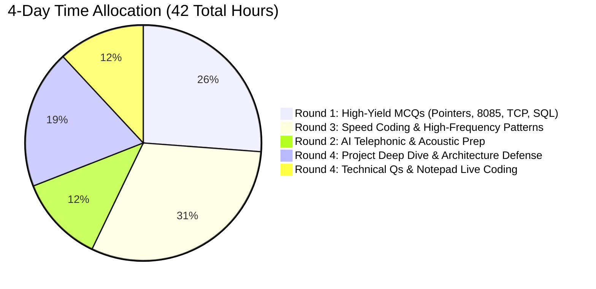

# DeltaX Associate Product Engineer — Master 4-Day Crash Plan (25–29 Sept 2026)

> **Timeline Context**:
> - **Today's Date**: 25 September 2026 (Evening ~7:00 PM)
> - **Official Campus Drive Date**: 29 September 2026
> - **Available Runway**: 3 Full Days + 2 Evenings/Mornings (~42 Intensive Focused Hours)
> - **Guiding Strategy**: Do NOT try to read all of Computer Science equally. Ruthlessly prioritize the **high-probability, elimination-critical topics** that decide shortlists in Rounds 1, 2, 3, and 4.

---

## High-Level Priority Allocation Matrix

---

## DAY 0: Friday, 25 September 2026 (Evening Kickoff: 7:00 PM – 11:30 PM)
*Goal: Lock down Round 1 high-frequency traps and baseline your current coding speed.*

| Time Window | Focus Area | Specific Actions & Files to Review | Target Deliverable |
| :--- | :--- | :--- | :--- |
| **7:00 PM – 8:15 PM** | **C/C++ & Java Language Traps** | Read [study_notes_programming_dsa.md](file:///c:/Users/naras/OneDrive/Desktop/DeltaX/DELTAX_PREPARATION/01_ROUND_1_MCQ/study_notes_programming_dsa.md). Focus on `*p++` vs `(*p)++`, operator precedence (`<<` vs `+`), integer overflow, static method hiding, and string immutability. | Solve first 50 questions in [programming_100_mcqs.md](file:///c:/Users/naras/OneDrive/Desktop/DeltaX/DELTAX_PREPARATION/01_ROUND_1_MCQ/programming_100_mcqs.md). |
| **8:15 PM – 9:00 PM** | **Microprocessors & Architecture** | Read [study_notes_microprocessors_arch.md](file:///c:/Users/naras/OneDrive/Desktop/DeltaX/DELTAX_PREPARATION/01_ROUND_1_MCQ/study_notes_microprocessors_arch.md). Memorize 8085 Flag Register bitmask (`S Z X AC X P X CY`), `INR/DCR` trap (affects all flags *except* Carry!), and interrupt vector addresses (TRAP=4.5, RST 7.5, 6.5, 5.5, INTR). | Solve 30 questions in [microprocessors_50_mcqs.md](file:///c:/Users/naras/OneDrive/Desktop/DeltaX/DELTAX_PREPARATION/01_ROUND_1_MCQ/microprocessors_50_mcqs.md). |
| **9:00 PM – 9:45 PM** | **Dinner Break & Mental Reset** | Step away from screens. Hydrate and clear your mind. | Break |
| **9:45 PM – 10:45 PM** | **Round 3 Coding Speed Drill** | Open [current_30_min_mocks/mocks_1_to_10.md](file:///c:/Users/naras/OneDrive/Desktop/DeltaX/DELTAX_PREPARATION/03_ROUND_3_CODING/current_30_min_mocks/mocks_1_to_10.md). Set a strict 30-minute timer and solve **Mock 1** (Parity reorder + Subarray sum divisible by K). | Compare your code against [current_30_min_mocks/solutions.md](file:///c:/Users/naras/OneDrive/Desktop/DeltaX/DELTAX_PREPARATION/03_ROUND_3_CODING/current_30_min_mocks/solutions.md). |
| **10:45 PM – 11:30 PM** | **Diagnostic Mock 1** | Open [mock_tests/mock_1.md](file:///c:/Users/naras/OneDrive/Desktop/DeltaX/DELTAX_PREPARATION/01_ROUND_1_MCQ/mock_tests/mock_1.md). Take Full 50-Q Round 1 Mock under 45-minute timed exam conditions. | Score using [answer_keys_and_scoring.md](file:///c:/Users/naras/OneDrive/Desktop/DeltaX/DELTAX_PREPARATION/01_ROUND_1_MCQ/mock_tests/answer_keys_and_scoring.md). Note weak sections. |

---

## DAY 1: Saturday, 26 September 2026 (Full Day: 8:30 AM – 11:00 PM)
*Goal: Master Core Computer Science Fundamentals for Round 1 & Lock Down Core Coding Patterns.*

| Time Window | Focus Area | Specific Actions & Files to Review | Target Deliverable |
| :--- | :--- | :--- | :--- |
| **8:30 AM – 10:30 AM** | **Computer Networks & Cybersecurity** | Study [study_notes_networks_cybersecurity.md](file:///c:/Users/naras/OneDrive/Desktop/DeltaX/DELTAX_PREPARATION/01_ROUND_1_MCQ/study_notes_networks_cybersecurity.md). Master TCP 3-way handshake packet sequence numbers, HTTP vs HTTPS TLS handshake, 401 vs 403, and SQLi / XSS / CSRF mechanisms. | Solve all 50 questions in [networks_50_mcqs.md](file:///c:/Users/naras/OneDrive/Desktop/DeltaX/DELTAX_PREPARATION/01_ROUND_1_MCQ/networks_50_mcqs.md) and 50 in [cybersecurity_50_mcqs.md](file:///c:/Users/naras/OneDrive/Desktop/DeltaX/DELTAX_PREPARATION/01_ROUND_1_MCQ/cybersecurity_50_mcqs.md). |
| **10:30 AM – 10:45 AM** | **Short Break** | Coffee / Walk | Break |
| **10:45 AM – 1:00 PM** | **Coding Patterns 1 & 2: Arrays, Strings, Hash Maps, Prefix Sum & Sliding Window** | Study [01_arrays_strings_pointers_sliding.md](file:///c:/Users/naras/OneDrive/Desktop/DeltaX/DELTAX_PREPARATION/03_ROUND_3_CODING/patterns/01_arrays_strings_pointers_sliding.md) and [02_hashing_prefix_xor_bits.md](file:///c:/Users/naras/OneDrive/Desktop/DeltaX/DELTAX_PREPARATION/03_ROUND_3_CODING/patterns/02_hashing_prefix_xor_bits.md). Focus on: Subarray Sum = K, Longest Substring Without Repeating Characters, and XOR bit manipulation. | Solve 6 exercises across these patterns. |
| **1:00 PM – 2:00 PM** | **Lunch Break** | Relax and recharge | Break |
| **2:00 PM – 4:00 PM** | **DBMS & Operating Systems** | Read [study_notes_oop_dbms_os.md](file:///c:/Users/naras/OneDrive/Desktop/DeltaX/DELTAX_PREPARATION/01_ROUND_1_MCQ/study_notes_oop_dbms_os.md). Review 1NF to BCNF normal forms, SQL Joins with NULLs, B+ tree vs Hash index, Coffman conditions, paging, and page fault sequence. | Solve 50 questions in [dbms_50_mcqs.md](file:///c:/Users/naras/OneDrive/Desktop/DeltaX/DELTAX_PREPARATION/01_ROUND_1_MCQ/dbms_50_mcqs.md) and 50 in [os_50_mcqs.md](file:///c:/Users/naras/OneDrive/Desktop/DeltaX/DELTAX_PREPARATION/01_ROUND_1_MCQ/os_50_mcqs.md). |
| **4:00 PM – 4:30 PM** | **Round 1 Timed Test 2** | Take [mock_tests/mock_2.md](file:///c:/Users/naras/OneDrive/Desktop/DeltaX/DELTAX_PREPARATION/01_ROUND_1_MCQ/mock_tests/mock_2.md) (45 minutes, 50 questions). | Track time per subject using 54-second rule. |
| **4:30 PM – 5:30 PM** | **Mock Review & Break** | Review incorrect answers using [answer_keys_and_scoring.md](file:///c:/Users/naras/OneDrive/Desktop/DeltaX/DELTAX_PREPARATION/01_ROUND_1_MCQ/mock_tests/answer_keys_and_scoring.md). | Rectify weak concepts. |
| **5:30 PM – 7:30 PM** | **Coding Patterns 3 & 4: Binary Search, Greedy, Recursion & Backtracking** | Study [03_binary_search_sorting_greedy.md](file:///c:/Users/naras/OneDrive/Desktop/DeltaX/DELTAX_PREPARATION/03_ROUND_3_CODING/patterns/03_binary_search_sorting_greedy.md) and [04_recursion_backtracking_dp.md](file:///c:/Users/naras/OneDrive/Desktop/DeltaX/DELTAX_PREPARATION/03_ROUND_3_CODING/patterns/04_recursion_backtracking_dp.md). Practice Combination Sum II (deduplication) and 0/1 Knapsack space optimization. | Code both solutions in Java and Python. |
| **7:30 PM – 8:30 PM** | **Dinner Break** | Healthy meal | Break |
| **8:30 PM – 9:45 PM** | **Speed Coding Mocks 2 & 3** | Solve Mock 2 (AdTech URL query sanitizer) and Mock 3 (Valid Palindrome II + Equal 0s/1s) from [current_30_min_mocks/mocks_1_to_10.md](file:///c:/Users/naras/OneDrive/Desktop/DeltaX/DELTAX_PREPARATION/03_ROUND_3_CODING/current_30_min_mocks/mocks_1_to_10.md). | Achieve clean execution within 30 minutes each. |
| **9:45 PM – 11:00 PM** | **Round 2 AI Telephonic Intro & Project Pitches** | Read [intro_and_company_questions.md](file:///c:/Users/naras/OneDrive/Desktop/DeltaX/DELTAX_PREPARATION/02_ROUND_2_AI/intro_and_company_questions.md) and [projects_deep_dive.md](file:///c:/Users/naras/OneDrive/Desktop/DeltaX/DELTAX_PREPARATION/04_ROUND_4_INTERVIEW/projects_deep_dive.md). Practice delivering your 30s and 60s pitches aloud into a voice recorder. | Eliminate filler words ("um", "basically"). |

---

## DAY 2: Sunday, 27 September 2026 (Full Day: 8:30 AM – 11:00 PM)
*Goal: Master Application-Based Parsing, BFS/Graphs & Deep Project Architecture Defense.*

| Time Window | Focus Area | Specific Actions & Files to Review | Target Deliverable |
| :--- | :--- | :--- | :--- |
| **8:30 AM – 10:30 AM** | **Application Parsing & Validation Mastery** | Study [06_parsing_validation_json_urls.md](file:///c:/Users/naras/OneDrive/Desktop/DeltaX/DELTAX_PREPARATION/03_ROUND_3_CODING/patterns/06_parsing_validation_json_urls.md). Master Email regex/manual parser, IPv4/IPv6 validator, and JSON key path extractor. | Solve 3 problems from [question_bank_application.md](file:///c:/Users/naras/OneDrive/Desktop/DeltaX/DELTAX_PREPARATION/03_ROUND_3_CODING/practice/question_bank_application.md). |
| **10:30 AM – 10:45 AM** | **Short Break** | Hydration | Break |
| **10:45 AM – 1:00 PM** | **Breadth-First Search & Monotonic Stack** | Study [05_stack_queue_linked_lists.md](file:///c:/Users/naras/OneDrive/Desktop/DeltaX/DELTAX_PREPARATION/03_ROUND_3_CODING/patterns/05_stack_queue_linked_lists.md). Focus on Rotten Oranges (multi-source BFS) and Next Greater Element / Largest Rectangle in Histogram. | Write solutions from memory in plain text editor. |
| **1:00 PM – 2:00 PM** | **Lunch Break** | Rest | Break |
| **2:00 PM – 4:00 PM** | **Historical 120-Min Mock Simulation (5 Problems)** | Open [historical_mocks/mocks_1_to_10.md](file:///c:/Users/naras/OneDrive/Desktop/DeltaX/DELTAX_PREPARATION/03_ROUND_3_CODING/historical_mocks/mocks_1_to_10.md). Attempt **Mock Test 1** or **Mock Test 2** under 120-minute timed conditions. Verify you clear $\ge 55\%$ test cases on *every* question. | Verify solutions using [historical_mocks/solutions.md](file:///c:/Users/naras/OneDrive/Desktop/DeltaX/DELTAX_PREPARATION/03_ROUND_3_CODING/historical_mocks/solutions.md). |
| **4:00 PM – 4:30 PM** | **Afternoon Walk / Rest** | Physical movement to combat fatigue | Break |
| **4:30 PM – 6:30 PM** | **ADAM-1 & Simha AI Technical Defense** | Study [project_questions_adam1.md](file:///c:/Users/naras/OneDrive/Desktop/DeltaX/DELTAX_PREPARATION/02_ROUND_2_AI/project_questions_adam1.md) and [projects_deep_dive.md](file:///c:/Users/naras/OneDrive/Desktop/DeltaX/DELTAX_PREPARATION/04_ROUND_4_INTERVIEW/projects_deep_dive.md). Master: TreeSHAP mathematics, pgvector HNSW indexing, FastAPI non-blocking event loops, and Supervisor agent state machines. | Be able to draw architecture and data flow on a blank sheet from memory. |
| **6:30 PM – 7:15 PM** | **Round 1 Timed Test 3** | Take [mock_tests/mock_3.md](file:///c:/Users/naras/OneDrive/Desktop/DeltaX/DELTAX_PREPARATION/01_ROUND_1_MCQ/mock_tests/mock_3.md) (45 minutes, 50 questions). | Analyze error patterns. |
| **7:15 PM – 8:15 PM** | **Dinner Break** | Recharge | Break |
| **8:15 PM – 9:45 PM** | **Smart Loan & Akki Assistant Defense** | Review [project_questions_simha_loan_akki.md](file:///c:/Users/naras/OneDrive/Desktop/DeltaX/DELTAX_PREPARATION/02_ROUND_2_AI/project_questions_simha_loan_akki.md). Master: SMOTE, ROC-AUC trade-offs, Telegram Webhooks, OAuth2 token refresh, and n8n Docker pipelines. | Practice vocal answers aloud. |
| **9:45 PM – 11:00 PM** | **Interactive Mock Interview 1** | Type `START ROUND 2 MOCK` or `START ROUND 4 MOCK` in chat to run an interactive live simulation with the engine. | Receive structured evaluation. |

---

## DAY 3: Monday, 28 September 2026 (The Polish & Confidence Sprint)
*Goal: Finalize Round 4 Technical Interview readiness, OOP design, Notepad live coding, and complete confidence.*

| Time Window | Focus Area | Specific Actions & Files to Review | Target Deliverable |
| :--- | :--- | :--- | :--- |
| **8:30 AM – 10:30 AM** | **100 Technical Interview Questions Drill** | Rapidly review all 100 questions in [100_technical_questions.md](file:///c:/Users/naras/OneDrive/Desktop/DeltaX/DELTAX_PREPARATION/04_ROUND_4_INTERVIEW/100_technical_questions.md). Test yourself on vtable mechanics, deadlock Coffman conditions, ACID enforcement, and TCP TIME_WAIT. | Flag any question where you cannot give a 2-sentence crisp answer. |
| **10:30 AM – 10:45 AM** | **Short Break** | Tea / Light stretch | Break |
| **10:45 AM – 12:30 PM** | **Resume & Tech Stack Deep Dive** | Review [resume_tech_stack_deep_dive.md](file:///c:/Users/naras/OneDrive/Desktop/DeltaX/DELTAX_PREPARATION/04_ROUND_4_INTERVIEW/resume_tech_stack_deep_dive.md). Focus on your core languages: Python, Java, JavaScript, FastAPI, PostgreSQL, and Docker. | Master the "Debugging" question scenarios. |
| **12:30 PM – 1:30 PM** | **Round 1 Timed Test 4** | Take [mock_tests/mock_4.md](file:///c:/Users/naras/OneDrive/Desktop/DeltaX/DELTAX_PREPARATION/01_ROUND_1_MCQ/mock_tests/mock_4.md). | Final timing calibration (54s per Q). |
| **1:30 PM – 2:30 PM** | **Lunch Break** | Nutritious meal | Break |
| **2:30 PM – 4:30 PM** | **Notepad Live Coding Practice** | Read [coding_defense_strategy.md](file:///c:/Users/naras/OneDrive/Desktop/DeltaX/DELTAX_PREPARATION/04_ROUND_4_INTERVIEW/coding_defense_strategy.md). Open blank Notepad. Write from scratch without compiling: 1. Subarray sum equals K, 2. Longest Palindromic Substring, 3. In-place string compression, 4. Rotten Oranges BFS. | Zero syntax errors, flawless indenting. |
| **4:30 PM – 5:30 PM** | **Round 2 AI Telephonic Behavioral & STAR Drill** | Read [behavioral_and_comm_questions.md](file:///c:/Users/naras/OneDrive/Desktop/DeltaX/DELTAX_PREPARATION/02_ROUND_2_AI/behavioral_and_comm_questions.md). Rehearse your 5 core behavioral stories (Conflict, Failure/Bug, Leadership, Tight Deadline, Disagreement) in STAR format. | Smooth, punchy 90-second delivery. |
| **5:30 PM – 6:30 PM** | **Round 1 Timed Test 5 (Final Confidence Mock)** | Take [mock_tests/mock_5.md](file:///c:/Users/naras/OneDrive/Desktop/DeltaX/DELTAX_PREPARATION/01_ROUND_1_MCQ/mock_tests/mock_5.md). | Confirm score $> 75\%$. |
| **6:30 PM – 7:30 PM** | **Light Exercise & Dinner** | Unwind, eat early | Break |
| **7:30 PM – 9:30 PM** | **Review All 20 Cheat Sheets** | Review all documents in [05_CHEAT_SHEETS/](file:///c:/Users/naras/OneDrive/Desktop/DeltaX/DELTAX_PREPARATION/05_CHEAT_SHEETS/). Lock in Big-O complexities, formulas, and syntax. | Total visual retention. |
| **9:30 PM – 10:30 PM** | **Logistics & Environment Check** | Test laptop webcam, microphone, internet connection, backup mobile hotspot, clean desk, install latest Chrome, and set 3 alarms. | Hardware verified. |
| **10:30 PM** | **SLEEP (Mandatory 8 Hours)** | Do NOT pull an all-nighter. Cognitive freshness and reaction speed in Round 1 and Round 3 are paramount. | Sleep |

---

## DAY 4: Tuesday, 29 September 2026 (Drive Day Master Timeline)

### Morning Warmup (6:30 AM – 9:30 AM)
- **6:30 AM**: Wake up, light physical stretch, hydrate with water.
- **7:00 AM – 8:00 AM**: Healthy high-protein breakfast. Avoid heavy carbohydrates that cause afternoon brain fog.
- **8:00 AM – 9:00 AM**: **Passive Formula & Cheat Sheet Scan** (Do NOT attempt new complex problems).
  - Review 8085 Flag Register bitmask and interrupt priority table.
  - Review TCP 3-way handshake packet sequence and HTTP status codes.
  - Review SQL join variations and normalization rules.
  - Review Kadane's algorithm, Two Pointers, and Prefix Sum templates.
- **9:00 AM – 9:30 AM**: Laptop setup:
  - Plug in power adapter (do not run on battery!).
  - Test external mouse and keyboard.
  - Close all background heavy applications (Spotify, Discord, heavy IDEs).
  - Open clean Chrome browser session.
  - Keep a water bottle and 2 blank paper sheets + pen for rough calculations.
- **9:30 AM – 10:00 AM**: Log in to college assessment portal early. Breathe deeply.

---

### Round-by-Round Execution Playbook (29 Sept)

#### ROUND 1: Technical MCQ (10:00 AM – 10:45 AM | 45 Mins, 50 Qs)
- **The 54-Second Rule**: You have exactly 54 seconds per question. Never spend $> 90$ seconds on a stubborn output-prediction question.
- **Phase 1 (First 20 Mins)**: Sweep through and immediately answer all fast factual questions (CN, OS, DBMS, Cybersecurity, Microprocessor flags).
- **Phase 2 (Next 20 Mins)**: Solve calculation and code output prediction questions (C pointers, DSA traversals, SQL joins).
- **Phase 3 (Final 5 Mins)**: Review flagged questions. If no negative marking, ensure every single question has an answer selected!

#### Intermission (10:45 AM – 12:30 PM)
- Hydrate and eat a light snack (banana, nuts).
- Review [intro_and_company_questions.md](file:///c:/Users/naras/OneDrive/Desktop/DeltaX/DELTAX_PREPARATION/02_ROUND_2_AI/intro_and_company_questions.md) and project pitches aloud.
- Warm up your vocal cords.

#### ROUND 2: AI Telephonic Interview (Starts 12:30 PM | 15–20 Mins)
- **Acoustic Clarity**: Sit in a dead-silent room with clear microphone input.
- **Cadence**: Speak deliberately at 130–150 words per minute.
- **Structure**: Answer in 3 clear bullet points. Avoid trailing off with filler words.
- **Confidence**: Reiterate keywords from your tech stack: *FastAPI, PostgreSQL pgvector, SHAP explainability, XGBoost, Docker, asynchronous workflows*.

#### Intermission (1:00 PM – 4:00 PM)
- Eat a balanced lunch. Rest your eyes for 30 minutes.
- From 3:00 PM – 3:45 PM: Re-read [current_30_min_mocks/solutions.md](file:///c:/Users/naras/OneDrive/Desktop/DeltaX/DELTAX_PREPARATION/03_ROUND_3_CODING/current_30_min_mocks/solutions.md) and [coding_defense_strategy.md](file:///c:/Users/naras/OneDrive/Desktop/DeltaX/DELTAX_PREPARATION/04_ROUND_4_INTERVIEW/coding_defense_strategy.md).

#### ROUND 3: Online Coding Test (Starts 4:00 PM | Officially 30 Mins / Historical 120 Mins)
- **If 30-Minute Sprint**:
  - Spend 2 minutes reading both problems carefully.
  - Solve the easier problem first to secure marks.
  - Check boundary conditions: empty array, single element, negative numbers, integer overflow.
- **If 120-Minute / 5-Question Format**:
  - **Remember the 55% Hard Cutoff**: You *must* pass test cases on all 5 questions.
  - Allocate 20 minutes per question. If stuck on Q5, do not leave Q1 or Q2 half-done. Ensure all baseline test cases pass across all problems!

#### ROUND 4: Technical Interview (Starts 5:00 PM | 45 Mins)
- **First 5 Minutes**: Deliver your crisp, enthusiastic introduction and why DeltaX excites you (AdTech scale, high throughput).
- **Coding Defense**: Use the **PADRE** method (Problem, Approach, Dry Run, Rigorous Complexity, Edge Cases).
- **When asked to code in Notepad**: Write syntactically valid code, indent cleanly, and talk aloud while typing.
- **Closing**: Ask 2 intelligent questions about DeltaX's engineering challenges (e.g., *"How does your bidding engine maintain sub-100ms latency during high-frequency holiday campaign surges?"*).
